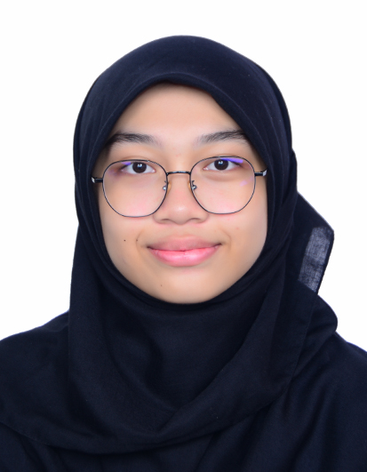

# Hi there, I'm Nurul Fatin Syafiqah Binti Hasan 👋

  <!-- YOUR PICTURE -->
  <!-- Upload your photo to your repo, name it profile.jpg, and keep the link below as 'profile.jpg' -->
  

  ### 🌱 CS Student @ Universiti Teknologi Malaysia (UTM)
  
  *Just starting my journey into tech and data engineering!*

---

## 🚀 About Me

* 🎓 **Major:** Bachelor of Computer Science (Data Engineering) at UTM.
* 💻 **Status:** Beginner coder, learning step-by-step every day.
* 🎯 **Goals:** Building my foundational skills, exploring programming, and working on cool uni projects.

---

## 🛠️ What I'm Learning

* **Languages:** Python, Java (Basics)
* **Tools:** Git, GitHub, VS Code

---

## 📫 Let's Connect!

* **GitHub:** [@nurulfatinsyafiqah](https://github.com/nurulfatinsyafiqah)
* **LinkedIn:** [Nurul Fatin Syafiqah Binti Hasan](https://linkedin.com/in/nurul-fatin-syafiqah-5a23a4443)
* **Email:** [nurulfatinsyafiqah@graduate.utm.my](mailto:nurulfatinsyafiqah@graduate.utm.my)

---

  Thanks for stopping by! ✨

